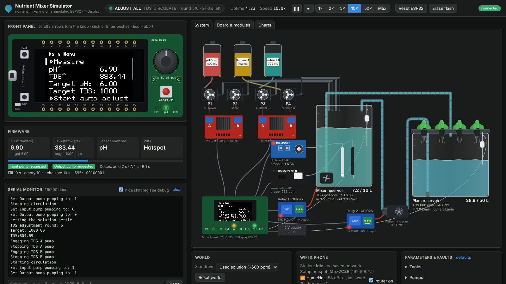
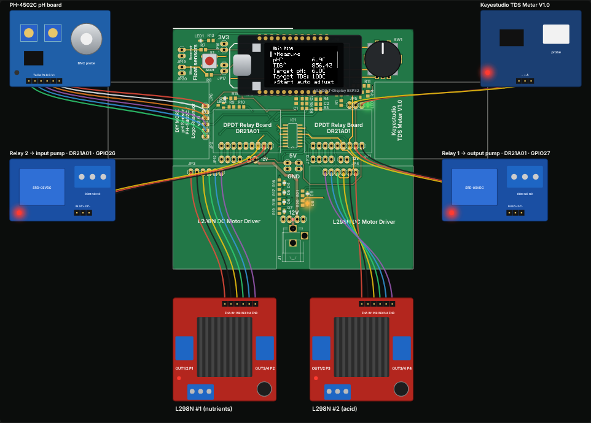

# Nutrient mixer simulator

Runs the firmware (`../nutrient_mixer.ino`, unmodified) on a Mac against a simulated T-Display ESP32, the mixer
board from `../eagle` and the hardware around it, and shows everything in the browser:

- **Front panel**: the T-Display with the live ST7789 contents, its IO0/IO35 buttons and reset button, the EC12E
  rotary encoder (scroll, drag, arrow keys; click or Enter pushes), the abort switch (Esc) and the LEDs.
- **System**: dosing bottles, the four peristaltic pumps on the two L298N drivers, the mixer reservoir with its
  float switch, probes and submersible pump, the self-priming pump, the plant reservoir, the DR21A01 relay
  boards, the probe boards and the mixer board, with water and nutrients flowing through the pipes.
- **Board & modules**: the board drawn from `eagle/untitled.brd` (copper, pads, silkscreen) with live net levels
  and LEDs, and the external modules (T-Display, L298N, DR21A01, PH-4502C, Keyestudio TDS meter) wired to their
  headers. Hover a pad or track to see its net and level.
- **Charts**: TDS, pH and volumes of both reservoirs, the firmware's own readings and the targets, and a pump
  timeline.
- **Serial monitor**, **WiFi & phone** (join the setup hotspot, scan the QR code on the display, fill in the
  setup page, switch routers off), **world actions** (tank volumes, bottle refills, presets) and **parameters &
  faults** (tank sizes, pump flows, concentrates, probe errors and location, stuck float switches, jammed pumps,
  pump supply).





## Running it

Needs the Xcode command line tools (`xcode-select --install`: clang, make, git and python3). The Arduino
libraries the firmware uses are downloaded on the first build (`scripts/fetch_deps.sh`, pinned versions).

```sh
cd simulator
make run          # builds, starts the simulator and opens http://localhost:8737
```

The terminal also works as the serial monitor (type `?` and Enter). Useful options of
`build/nutrient-mixer-sim` (`--help` lists them all):

- `--speed 10` runs ten times faster than real time (`0` as fast as possible); the speed can also be changed
  in the UI, and the simulation can be paused and stepped
- `--reset` erases the simulated flash (NVS: targets, pump amounts, calibration, WiFi credentials) and resets
  the world. Both are kept in `simulator/state/` across runs, like on the real device and in the real world.
- `--port 9000` serves the UI on another port

`make test` runs the scenario scripts in `scenarios/` headless (see `scenarios/README.md`).

## How it works

```
nutrient_mixer.ino ──► scripts/gen_prototypes.py ──► build/gen/nutrient_mixer.ino.cpp ─┐
GEM, Adafruit GFX, KeyDetector, AiEsp32RotaryEncoder, PH4502C, qrcodegen (.deps) ──────┤
hal/: Arduino core, Serial, Preferences, SPI, ST7789, WiFi, WiFiManager, qrcode ───────┤──► nutrient-mixer-sim
src/: virtual clock, board (GPIO, 74HC595, L298N, relays, probe boards, encoder),       │      │  WebSocket
      world (reservoirs, pumps, chemistry), WiFi world, scenarios, web server ─────────┘      ▼
                                                                                      web/ (browser UI)
```

- **The firmware is compiled as is.** Like the Arduino builder, `gen_prototypes.py` adds `#include <Arduino.h>`
  and the function prototypes. The real libraries are compiled with it; only the hardware layer below them is
  simulated (`hal/`). `src/firmware_unit.cpp` reads the firmware's variables (state machine, readings, targets)
  for the UI.
- **Virtual time.** Every Arduino call costs a few microseconds of virtual time, `delay()` costs what it asks
  for, display drawing costs its SPI transfer time (40 MHz) and serial output its UART time (115200 baud, the
  firmware blocks when the 128 byte FIFO is full). The physics advances in 10 ms steps and UI inputs are applied
  at defined virtual times, so a run is the same at any speed and the speed only paces virtual time against
  real time. Interrupts (the encoder) run when the input changes, between Arduino calls.
- **Electronics** follow the schematic: GPIO26/27 drive the relay boards (active high, configurable), the
  74HC595 is simulated bit by bit from SR_SER/SR_SCK/SR_RCK/SR_SCL and its outputs drive the L298N enables and the
  shared IN1/IN3 (PPUMP_A) and IN2/IN4 (PPUMP_B) inputs, the debug LEDs and the BSS123 switches that power the
  probe boards. The float switches pull GPIO37/38 low against R7/R8. The probe boards' outputs reach the ADC
  through the 10k/20k dividers; the ADC model has noise, motor spikes, the ESP32's 142 mV floor and saturation
  at about 3.13 V. The probe boards need a moment to settle after power on, and interfere when both are powered
  in the same liquid.
- **Water and chemistry.** Each reservoir holds a solution described by its volume, dissolved solids, strong ion
  difference, carbonate and phosphate. The pH follows from the charge balance, so phosphoric acid lowers it,
  the phosphate of nutrient B buffers it, bicarbonate in tap water resists it and CO2 slowly escapes so the pH
  drifts up. The probes follow the reservoir with a delay that is shorter while pumps stir the water. Pumps
  have flows, the self-priming pump needs time to prime and loses it when its hose sucks air, the submersible
  pump runs dry below its intake, and reservoirs overflow.
- **WiFi** is simulated with a few networks and a phone: the firmware's WiFiManager calls behave like the
  library (non-blocking portal, pre-save and save callbacks, connect timeout), the credentials are stored in
  NVS and the station reconnects when a router comes back.

The defaults match the firmware's default calibration, so the firmware reads the true values at 25 °C. The
default water temperature is 22 °C, which makes the TDS read about 6 % low because the firmware assumes 25 °C.

## What the simulator shows about the current firmware

Running the firmware in the simulator brought up these points (the firmware has not been changed):

1. **A key press at every boot.** `KeyDetector myKeyDetector(keys, ...)` uses the default `pullup = false`, so a
   HIGH input counts as pressed. GPIO0 has a pull-up on the T-Display and reads HIGH when the button is not
   pressed, so the first `loop()` sees `GEM_KEY_RIGHT`. Without WiFi credentials this closes the setup QR
   screen right after it is shown; with credentials it activates the selected menu item (Measure). Pressing
   IO0 sends the key on release instead of on press. Passing `pullup = true` to `KeyDetector` would fix both.
2. **The first knob detent after boot goes the wrong way.** The encoder starts at 0 with
   `setBoundaries(0, 1000, true)`; turning clockwise wraps to 1000, which `rotary_loop()` sees as a +1000 change
   (menu up). Starting from the middle (`rotaryEncoder.setEncoderValue(500)`) would avoid it. Quick turns also
   trigger the library's acceleration, but only the sign of the change is used.
3. **The adjustment stops on the mixer reading.** The probes are in the mixer reservoir, the doses go into it,
   and the 40 s circulation exchanges only a part of it (3 L/min with a 6 L mixer reservoir). With the default
   settings `scenarios/auto_adjust.sim` ends with the mixer at about 960 ppm / pH 5.9 while the plant reservoir is
   at about 710 ppm / pH 6.9. Longer circulation (or measuring the plant reservoir) would help.
4. **TDS readings saturate at about 1290 ppm** with the default calibration (3.1 V at the ADC), while the target
   can be set up to 3000 ppm.
5. **The WiFi setup screen draws its text in the menu font.** GEM leaves its own font (GFX fonts place the
   cursor at the text baseline) set on the display, and `showWifiQrCode()` does not reset it, so "Scan to" at
   y = 4 is cut off at the top edge and the labels overlap the names below them. `tft.setFont()` at the start
   of `showWifiQrCode()` would restore the built-in font.
6. **The dosing pump wiring disagrees with the board.** The firmware uses PPUMP1 for acid and PPUMP3/4 for B/A
   (with a TODO), the silkscreen puts the nutrients on the left L298N (PPUMP1/2) and acid on the right one.
   Parameters > Pumps > Dosing tube wiring switches between the two.

## Limitations

- The ESP32 itself is not emulated: the firmware runs as native code, so timing is modelled (as above) rather
  than cycle accurate, and memory or stack problems of the ESP32 do not show up.
- The WiFiManager web portal is replaced by the phone panel in the UI; no real network is involved.
- The module footprints and the DR21A01 and probe board circuits are drawn and modelled from their names on
  the board and common versions of these modules; the relay boards' extra contacts (RELAY*_NC, PUMP*- on
  JP1/JP2) are not modelled.
- The temperature output of the pH board is approximate (the firmware does not use it yet).
