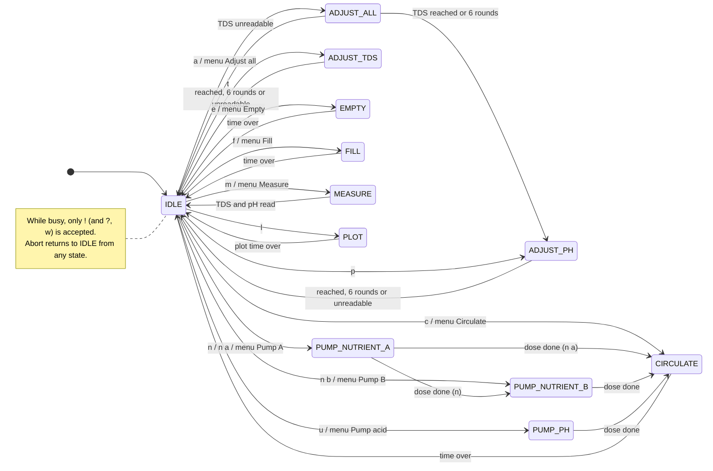
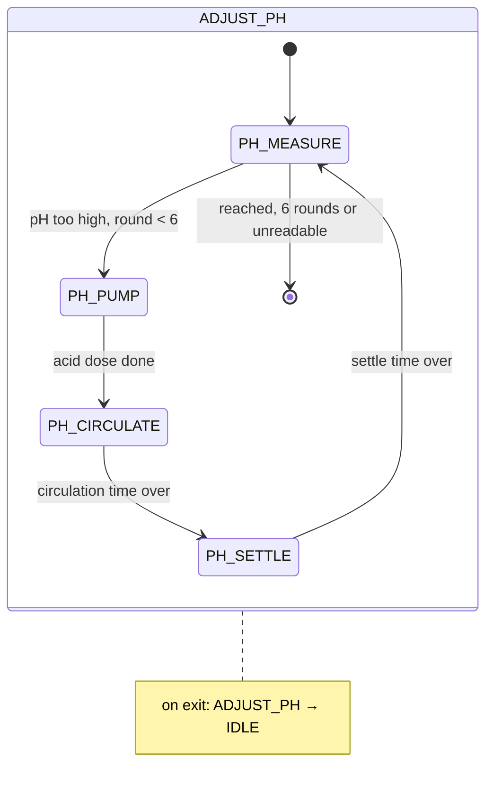
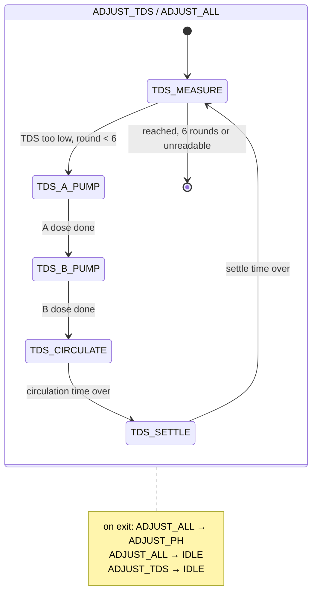

# TLA+ model of the firmware state machine

`NutrientMixer.tla` models the control logic of `../nutrient_mixer.ino`: the
operation `state` in `loop()`, the `phAdjustment()` and `tdsAdjustment()`
sub-machines and their round counters, the shared `countDown` timer, which
sensor is powered, the `measureAll()` step and which pumps are requested.

Each `loop()` iteration is two steps: `pc = "read"` applies at most one
command (serial, menu or abort switch) through `handleCommand()`, and
`pc = "exec"` runs one slice of the current operation. Timer expiry, sensor
warm-up and sensor results are nondeterministic, so TLC explores every
ordering. Targets, durations, calibration, WiFi and the display are left
out. The float switches are not modelled: they only gate the relays in
`updatePumps()`, so `pumps` is what the firmware has requested.

## Checked properties (`MC.cfg`)

| Property | Meaning |
| --- | --- |
| `IdleMeansPumpsOff` | Back in IDLE, no pump is requested. |
| `IdleMeansTimerFree` | The shared countdown is not left running in IDLE. |
| `IdleMeansSensorsOff` | Both sensors are powered down in IDLE. |
| `AcidOnlyWhenDosing`, `NutrientAOnlyWhenDosing`, `NutrientBOnlyWhenDosing` | A dosing pump only runs in its own dosing state. |
| `OneDosingPumpAtATime` | Never more than one peristaltic pump at once. |
| `NoDosingWhileCirculating` | No dosing while the tank circulates. |
| `SensorsOnlyWhenMeasuring` | A sensor is only powered by an operation that reads it. |
| `OperationsFinish` | Every operation returns to IDLE (liveness, assuming time passes and readings complete). |

All hold: 1,092 distinct states, no deadlocks.

The model was checked against reintroduced bugs to make sure the properties
can fail. Accepting commands while busy, not cancelling the timer on abort,
removing the round limit and dropping the progress assumption each produce a
counterexample. Removing `cancelCountDown()` from `startOperation()` does
not: the busy check means it only runs with the timer already stopped, so
that call is a safety net.

## Run it

```bash
curl -LO https://github.com/tlaplus/tlaplus/releases/download/v1.8.0/tla2tools.jar
```

```bash
java -cp tla2tools.jar tlc2.TLC -config MC.cfg -dump dot,actionlabels graph NutrientMixer.tla
```

```bash
python3 graph_to_mermaid.py graph.dot > diagrams.md
```

## Diagrams

Projected from the TLC state graph onto `state` and the adjustment sub-states.

### Top-level `loop()` state



### `pHadjustment()` sub-machine



### `TDSadjustment()` sub-machine


