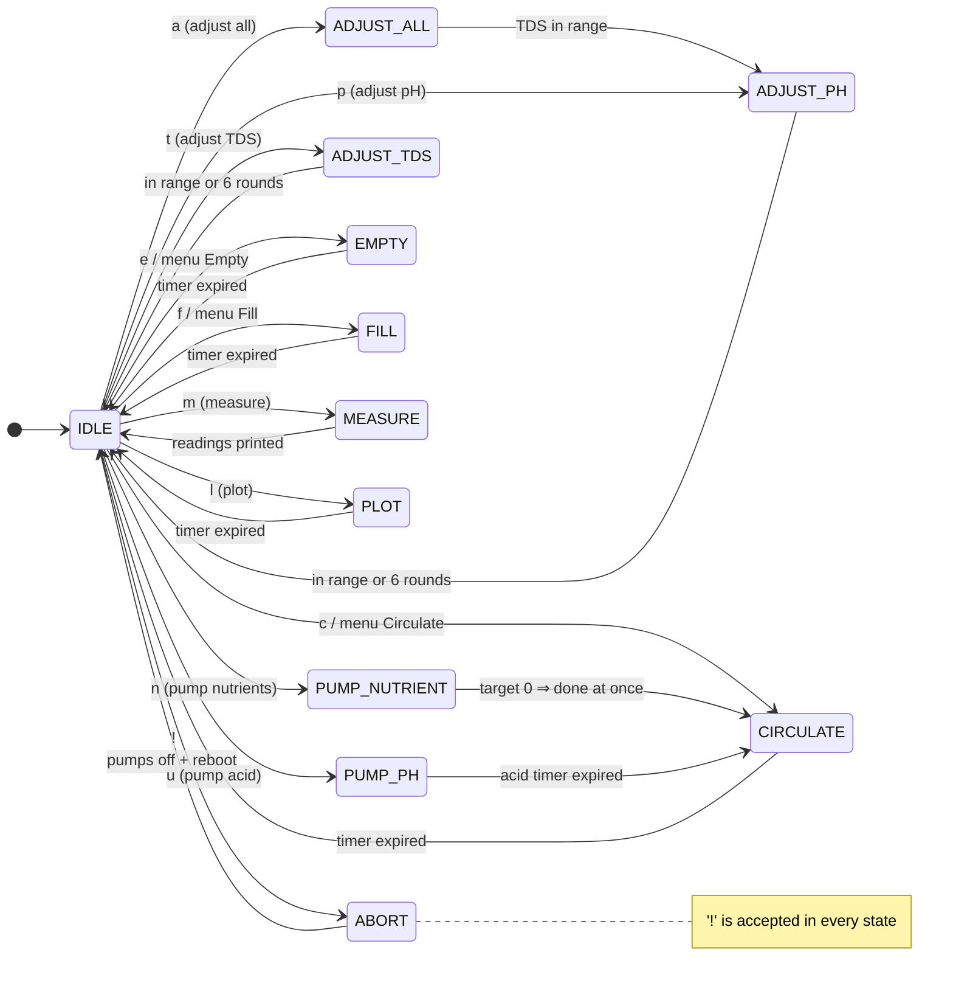
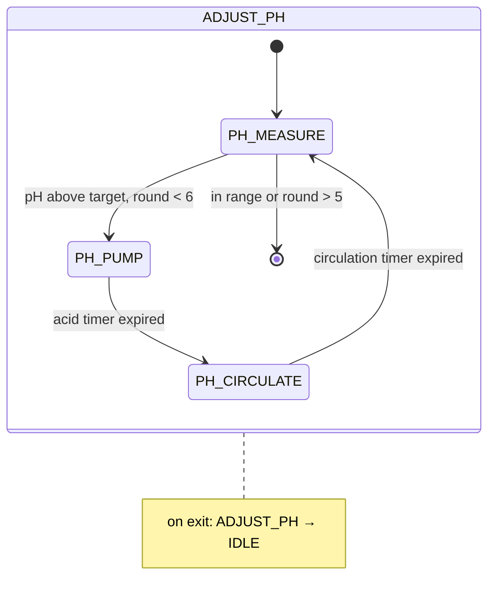
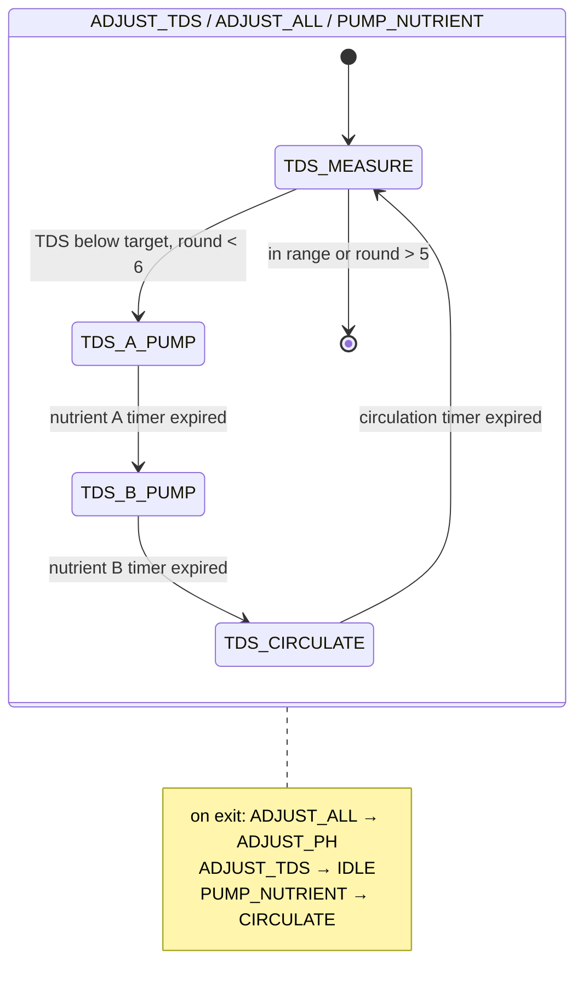

# TLA+ model of the firmware state machine

`NutrientMixer.tla` models the control logic of `../nutrient_mixer.ino`:
the top-level `State` in `loop()`, the `pHadjustment()` and `TDSadjustment()`
sub-machines, their round counters, the shared `runCountDown()` timer and
which pumps are energised.

Each `loop()` iteration is two steps: `pc = "read"` applies an incoming
command (`switch (command)`), and `pc = "exec"` runs one slice of work
(`switch (state)`). Timer expiry and sensor results are nondeterministic,
so TLC explores every ordering.

| Config | Purpose |
| --- | --- |
| `MC_graph.cfg` | Intended behaviour: commands only when IDLE, `!` anytime. Used to draw the diagrams. |
| `MC_firmware.cfg` | Faithful to the code: commands are applied even while busy. Checks safety invariants. |
| `MC_boot.cfg` | Checks the pump state that `setup()` leaves behind. |

## Regenerate the diagrams

```bash
curl -LO https://github.com/tlaplus/tlaplus/releases/download/v1.8.0/tla2tools.jar
```

```bash
java -cp tla2tools.jar tlc2.TLC -config MC_graph.cfg -dump dot,actionlabels graph NutrientMixer.tla
```

```bash
python3 graph_to_mermaid.py graph.dot > diagrams.md
```

## Check the invariants

```bash
java -cp tla2tools.jar tlc2.TLC -config MC_firmware.cfg NutrientMixer.tla
```

## Diagrams


### Top-level `loop()` state



### `pHadjustment()` sub-machine



### `TDSadjustment()` sub-machine



## What TLC found (`MC_firmware.cfg`, `MC_boot.cfg`)

1. **A command sent mid-operation leaves pumps running.** `loop()` prints
   "Operation in progress" but still applies the command. Trace: `e` (output
   pump on, timer armed), then `t`: `TDSadjustment()` finishes at once and the
   machine is IDLE with the output pump still on. Violates `IdleMeansPumpsOff`.
2. **The shared countdown leaks between operations.** `runCountDown()` keeps
   one `static` timer for every caller. In the same trace it stays armed in
   IDLE (`IdleMeansCountdownFree`), so the next timed operation skips its
   `start()` callback and only runs `stop()`.
3. **Acid pump can keep dosing outside a dosing state.** `u` then `t`
   leaves the acid pump on in `ADJUST_TDS` (`AcidOnlyWhenDosing`).
4. **Relays are on at boot.** `setup()` writes HIGH to both relay pins, which
   `engagePump()` treats as "pumping" (`MC_boot.cfg`). GPIO 38/39 are also
   input-only on the ESP32, as the TODO at the top of the sketch suspects.
5. **`n` never pumps nutrients.** `PUMP_NUTRIENT` calls `TDSadjustment()`
   with its default target 0, which returns done from `TDS_MEASURE`, so the
   machine goes straight to `CIRCULATE`. It only doses if an interrupted TDS
   adjustment left the sub-machine mid-cycle.
